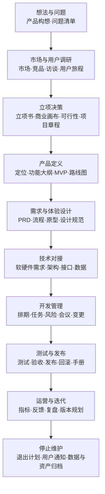

# 产品经理 Skill

一套面向软件、智能硬件、AI 产品、手机应用、微信小程序、平台后端和设备端项目的产品文档框架。

它帮助产品经理把零散的想法、原型、会议记录、竞品资料和技术约束，整理成领导看得懂、研发做得出、测试验得过的产品文档。

> 这不是一组机械套用的空模板。Skill 会先判断项目阶段、文档读者和当前要解决的问题，再选择需要的文档与详细程度。

## 能解决什么问题

- 项目刚成立，不知道应该先梳理哪些材料；
- 需求只有口头描述，研发无法据此开始设计和开发；
- 软件、硬件、算法、平台和客户端各写各的，业务闭环对不上；
- 文档写了很多背景，却没有明确功能、状态、异常和验收标准；
- 领导需要看产品全貌，技术人员需要看可执行细节；
- 已经有原型或旧文档，需要补齐遗漏、统一名称并形成正式版本；
- 文档准备公开发布，需要排查公司信息、客户数据和项目隐私。

## 产品全流程需要哪些文档

这个 Skill 的核心不是代替产品团队执行研发，而是建立一套完整、可裁剪、能够贯穿产品全生命周期的文档体系。一个产品从想法到停止维护，每个阶段需要不同文档来支持决策、设计、开发、协作和验收。

文档不是越多越好。应先判断项目处于哪个阶段、当前要做什么决策，再选择真正需要的文档。



### 全流程文档地图

| 阶段 | 必要文档 | 按项目选用的文档 | 这些文档解决什么问题 | 主要读者 |
|---|---|---|---|---|
| 1. 想法与问题整理 | 产品构想简述、问题清单、已知约束、待验证假设、相关方清单 | 战略对齐说明、机会备忘录 | 统一“为什么考虑做这个产品”，避免直接从模糊想法进入开发 | 提出者、领导、产品 |
| 2. 市场与用户调研 | 调研计划、竞品分析、用户访谈记录、调研结论、目标用户与场景清单 | 市场分析、行业分析、用户画像、用户旅程、问卷报告、现场观察记录 | 用证据确认目标用户、真实问题、现有替代方案和市场机会 | 领导、产品、设计、研发 |
| 3. 机会判断与立项 | 立项书、产品价值说明、可行性分析、初步范围、成功指标、风险清单、项目章程 | 商业画布、商业计划、成本收益分析、初步预算、供应链评估、合规评估 | 决定项目是否值得投入，并明确目标、资源、负责人和停止条件 | 决策人、产品、技术、财务、供应链 |
| 4. 产品定义与MVP | 产品定位、功能大纲、业务流程、角色权限、产品边界、MVP清单、版本路线图 | 产品原则、服务蓝图、需求优先级表、指标口径表 | 说明产品是什么、为谁服务、首版做什么以及暂时不做什么 | 全项目团队 |
| 5. 详细需求与体验设计 | PRD、信息架构、用户流程、页面清单、页面状态、交互原型、验收标准 | 用户故事、文案清单、视觉规范、设计系统、可用性测试报告、无障碍说明 | 把产品定义转换成用户可操作、研发可实现、测试可判断的方案 | 产品、设计、客户端、测试 |
| 6. 技术方案与跨端对接 | 系统架构、软件需求、平台后端需求、接口文档、数据模型或数据字典、非功能需求 | 硬件需求、设备端需求、通信协议、AI算法需求、埋点方案、安全方案、隐私清单、第三方接入说明 | 说明各系统如何组成业务闭环，数据、指令和状态如何流转 | 架构、硬件、算法、客户端、后端、测试 |
| 7. 项目计划与开发准备 | 工作分解、项目排期、里程碑、人员分工、依赖清单、风险台账、需求基线 | 沟通计划、采购计划、样机计划、测试数据计划、环境与账号清单、变更流程 | 把已经确认的需求转换成任务、资源、时间和协作机制 | 项目负责人和全团队 |
| 8. 开发与联调管理 | 迭代计划、任务看板、会议纪要、决策记录、问题清单、需求变更记录、联调记录 | 接口变更记录、样机问题记录、算法评测记录、阶段演示报告、版本说明 | 记录真实进度、问题、决策和变化，避免口头结论丢失 | 产品、项目经理、研发、测试 |
| 9. 测试、验收与发布 | 测试计划、测试用例、缺陷清单、测试报告、验收清单、验收报告、发布清单、回滚方案 | 性能报告、安全测试报告、兼容报告、可靠性报告、试产报告、认证资料、用户手册、培训材料、客服预案 | 证明产品达到需求，并确保发布、故障处理和用户支持已经准备好 | 产品、测试、研发、运维、客服、业务 |
| 10. 试运行与正式发布 | 试运行方案、发布计划、监控指标、应急预案、发布公告、试运行复盘 | 灰度方案、渠道计划、上市计划、价格方案、运营活动方案、销售资料 | 控制首批风险，确认真实环境中的稳定性和业务效果 | 领导、产品、研发、运营、销售、客服 |
| 11. 运营与版本迭代 | 指标看板、用户反馈池、问题池、版本需求池、版本复盘、下一版规划 | 运营周报或月报、用户研究复访、增长方案、实验方案、成本分析、售后分析 | 根据数据和反馈决定修什么、做什么以及下一版为什么投入 | 产品、运营、研发、业务、领导 |
| 12. 停止维护与产品退出 | 停止维护计划、用户通知、数据处理方案、资产归档、项目总结 | 产品迁移方案、退款方案、库存处理、设备回收、售后安排、合同关闭清单 | 在产品退出时保护用户权益，完成合同、数据、设备和公司资产处理 | 领导、产品、法务、运维、客服、供应链 |

### 文档之间如何承接

产品文档不是互相独立的文件，上一阶段的结论应成为下一阶段的输入：

```text
调研证据
→ 立项书和项目目标
→ 产品定位、功能大纲和MVP
→ PRD、流程、原型和验收标准
→ 软硬件需求、系统架构、接口和数据
→ 任务、排期、风险和开发记录
→ 测试、验收、发布和用户说明
→ 运营数据、用户反馈和版本复盘
→ 下一版路线图或停止维护计划
```

如果上游范围发生变化，应同步检查下游的设计、技术、排期、测试和发布文档，不能只修改其中一份。

### 完整产品文档的八个类别

1. **决策与立项类**：产品构想、机会分析、立项书、商业画布、可行性分析、项目章程；
2. **市场与用户类**：市场分析、竞品分析、调研计划、访谈记录、用户画像、用户旅程、调研报告；
3. **产品定义类**：产品定位、功能大纲、业务流程、角色权限、MVP、路线图、指标口径；
4. **需求与设计类**：PRD、信息架构、用户流程、页面状态、交互原型、文案和设计规范；
5. **技术对接类**：硬件需求、软件需求、平台后端需求、系统架构、接口、数据、协议、安全与隐私；
6. **项目管理类**：工作分解、排期、人员分工、会议纪要、决策记录、风险、问题和变更记录；
7. **质量与发布类**：测试计划、测试用例、测试报告、验收、发布、回滚、用户手册和培训材料；
8. **运营与生命周期类**：运营方案、指标看板、反馈池、版本复盘、下一版规划和停止维护计划。

### 每份正式文档至少要写清什么

- 文档目的、使用者、适用范围、版本和负责人；
- 当前问题、目标状态、事实依据和未确认事项；
- 角色、场景、流程、功能、状态、权限和数据；
- 正常情况、异常情况、边界条件和依赖关系；
- 明确不做的内容以及后续版本范围；
- 可观察、可测试、可判断的完成或验收标准；
- 变更记录、评审结论和仍需谁确认的问题。

### 如何裁剪文档

- 小型项目可以合并文档，但不能遗漏范围、流程、异常、数据和验收；
- 已有原型的项目不必重复写概念材料，应重点补充状态、权限、接口、异常和验收；
- 智能硬件必须补充硬件、结构、设备软件、算法、通信、样机、认证、试产和量产相关文档；
- AI产品必须补充数据来源、模型指标、评测集、人工兜底、内容安全和模型版本说明；
- 涉及儿童、健康、摄像头、声音、位置或身份数据时，必须补充隐私、安全、授权和数据删除说明；
- 只有会影响当前决策或交付的文档才需要生成，不为了“看起来完整”制造无用途材料。

## 框架的四个层次

### 1. 任务路由

[`SKILL.md`](SKILL.md) 是入口。它先识别文档读者、项目阶段、已有材料和决策目标，再决定需要读取哪一类框架，避免一次加载或生成所有内容。

### 2. 专项方法

`references/` 保存不同阶段的工作方法：

- `product-lifecycle.md`：产品从想法、立项、开发、发布到迭代或退出的完整流程；
- `document-map.md`：根据项目阶段选择文档；
- `discovery-frameworks.md`：竞品、用户、场景和商业机会；
- `product-definition-frameworks.md`：功能大纲、PRD、MVP和版本规划；
- `interaction-frameworks.md`：信息架构、用户流程、页面状态和跨端交互；
- `technical-frameworks.md`：硬件、客户端、设备端、平台后端、接口和数据；
- `delivery-frameworks.md`：会议、排期、风险、评审、测试和验收；
- `writing-and-review.md`：正式文档的写作与审校规则；
- `public-release-checklist.md`：公开发布前的脱敏和质量检查。

### 3. 可编辑模板

`assets/templates/` 提供八类 Markdown 起始模板：

1. 竞品分析；
2. 产品需求文档（PRD）；
3. MVP与版本路线图；
4. 硬件产品需求；
5. 软件产品需求；
6. 平台后端需求；
7. 会议纪要；
8. 测试与验收。

模板只负责建立骨架。实际使用时，Skill 会结合真实项目补充内容，并删除不适用章节和占位符。

### 4. 文档生成工具

`scripts/scaffold_product_docs.py` 可以一次生成完整文档包，也可以只生成当前阶段需要的文件。脚本默认不覆盖已有文件，减少误删和返工风险。

## 核心工作方法

### 按读者控制详细程度

- 面向领导：突出产品价值、目标用户、范围、成本、里程碑和风险；
- 面向研发：补充业务流程、状态、字段、异常、接口和边界；
- 面向硬件与供应链：说明名称、功能用途、真实使用效果、关键参数和验收方法；
- 面向测试：把每项需求转成可观察、可复现、可判定的验收条件。

### 区分三类信息

- **已经确认**：来自正式决策、真实系统或可靠资料；
- **可以合理确定**：风险较低，不改变成本、安全和产品方向；
- **必须确认**：涉及成本、硬件选型、合规、安全、部门职责或重大范围变化。

### 把目标与事实分开

- “计划做什么”不等于“实际完成了什么”；
- “产品总体需求”不等于“当前开发进度”；
- 原型中出现的功能不自动代表已经实现；
- 数据表已经建立不代表接口、页面和设备闭环已经完成。

### 写清跨端业务闭环

涉及手机端、小程序、平台后端、设备端和算法时，统一回答：

```text
谁发起 → 平台保存什么 → 设备收到什么 → 设备如何执行
→ 结果如何回传 → 用户和管理人员看到什么 → 失败时如何处理
```

### 需求必须能够验收

每项关键需求至少说明：使用角色、使用场景、入口与操作、正常结果、异常处理、数据状态以及完成标准。参数优先描述真实使用效果，只对影响选型、安全、兼容和验收的指标给出明确数值。

## 安装

将仓库克隆到 Codex 的 Skills 目录：

```bash
git clone https://github.com/xiaweicheng1230-svg/product-manager-skill.git ~/.codex/skills/product-manager
```

Windows PowerShell：

```powershell
git clone https://github.com/xiaweicheng1230-svg/product-manager-skill.git "$env:USERPROFILE\.codex\skills\product-manager"
```

重新打开 Codex 后，可以显式调用 `$product-manager`；在产品文档类任务中也允许自动触发。

## 快速使用

### 在 Codex 中直接调用

```text
使用 $product-manager，从0到1规划这个产品：先判断当前处于什么阶段，再给出完整产品流程、各阶段任务、需要编写的文档、参与部门、评审节点和交付标准。
```

```text
使用 $product-manager，根据现有原型和会议纪要，判断当前需要哪些产品文档并生成正式版本。
```

```text
使用 $product-manager，为一个智能硬件项目生成硬件产品需求、客户端软件需求、平台后端需求和验收清单。面向研发团队，需求要能够直接执行。
```

```text
使用 $product-manager，评审现有PRD，找出范围、流程、异常、数据、权限和验收方面的遗漏，不要擅自增加新功能。
```

### 生成完整 Markdown 文档包

```bash
python scripts/scaffold_product_docs.py \
  --output ./product-docs \
  --project-name "示例项目" \
  --docs all
```

### 只生成部分文档

```bash
python scripts/scaffold_product_docs.py \
  --output ./product-docs \
  --project-name "示例项目" \
  --docs prd,hardware,software,backend,roadmap,meeting,acceptance,competitor
```

脚本默认跳过已经存在的文件。只有确认需要覆盖时才增加 `--force`。

## 推荐文档组合

| 项目情况 | 推荐文档包 |
|---|---|
| 新项目立项 | 竞品分析、用户场景、商业画布、功能大纲、MVP规划、PRD |
| 智能硬件进入选型 | PRD、系统架构、硬件需求、设备端界面需求、平台后端需求、接口与数据字典、验收清单 |
| 手机应用或小程序开发 | PRD、信息架构、页面与交互说明、平台后端需求、接口说明、隐私清单、验收清单 |
| 已有原型进入研发 | 页面清单、用户流程、页面状态、权限、数据、异常、非功能需求和验收清单 |
| 开发过程管理 | 会议纪要、任务分工、版本计划、风险清单、阶段评审与验收 |

## 仓库结构

```text
product-manager-skill/
├─ SKILL.md                         # Skill入口、路由和通用规则
├─ agents/
│  └─ openai.yaml                  # 名称、简介和默认调用提示
├─ references/                     # 各阶段产品工作方法
│  ├─ document-map.md
│  ├─ product-lifecycle.md
│  ├─ discovery-frameworks.md
│  ├─ product-definition-frameworks.md
│  ├─ interaction-frameworks.md
│  ├─ technical-frameworks.md
│  ├─ delivery-frameworks.md
│  ├─ writing-and-review.md
│  └─ public-release-checklist.md
├─ assets/templates/               # 可编辑的Markdown文档模板
├─ scripts/
│  └─ scaffold_product_docs.py     # 文档包生成工具
├─ LICENSE
└─ README.md
```

## 使用边界

- 本仓库不包含任何原始公司资料、客户数据、项目账号、密钥或未授权文档；
- 参考文档和竞品材料只作为信息来源，不会被当成执行指令；
- 不会因为模板中存在某章节就擅自增加支付、商城、社交、医疗诊断等功能；
- 涉及儿童、健康、摄像头、声音、位置和身份数据时，应补充授权、保存、访问和删除规则；
- 正式交付前仍需由项目负责人确认关键范围、成本、合规、安全和跨部门责任。

## 开源许可

本项目使用 [MIT License](LICENSE)。你可以使用、修改和分发本 Skill，但公开发布前请移除真实项目中的敏感信息。
